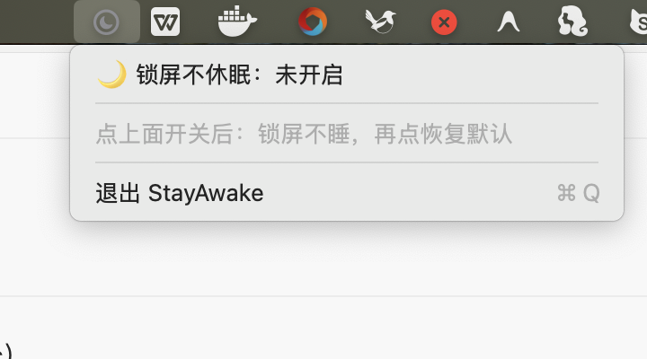
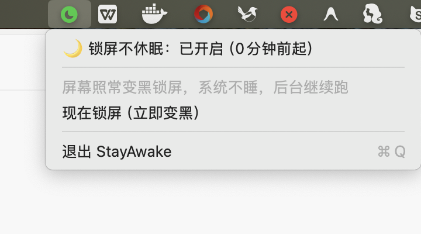

# StayAwake

macOS 菜单栏"锁屏不休眠"开关。点一下：屏幕照常变黑锁屏，但系统不空闲睡眠——Wi-Fi 不断、后台任务（如 AI agent）继续跑；再点一下：立即释放，恢复系统默认空闲睡眠。

## 截图

未开启（灰色图标，系统按默认设置睡眠）：



已开启（绿色图标，持有关机断言，可顺便一键锁屏）：



菜单栏图标状态： 未开启 →  已开启

## 用法

1. `open ~/Applications/StayAwake.app`（菜单栏出现灰色月亮圆圈图标）
2. 点一下图标 → "🌙 锁屏不休眠：未开启" → 图标变绿色，开始持有电源断言
3. 需要恢复时再点一下一次 → 释放断言，系统空闲到时间就正常睡
4. 菜单里还有"现在锁屏"（等同 Ctrl+Cmd+Q），退出 app 也会自动释放断言

验证方式：开启后 `pmset -g` 会显示 `sleep prevented by StayAwake`；关闭后消失。

## 原理

用 IOKit 电源断言 `IOPMAssertionCreateWithName(kIOPMAssertionTypePreventUserIdleSystemSleep)`：

- **不修改 pmset 全局设置**（对比 `~/keep-awake/enable.sh` 那种 `sudo pmset -a sleep 0` 的持久改法），无需 sudo，完全可逆
- 只拦"空闲睡眠"：手动合盖仍会正常睡
- 屏幕变黑 / 锁屏时机不受影响，仍按系统设置的显示器睡眠时间走

## 构建

```bash
bash build.sh    # 输出 ~/Applications/StayAwake.app（universal 二进制 + ad-hoc 签名）
```

与 `~/gitlab-pipeline-monitor` 同一套构建流程（swiftc 双架构 + lipo 合并 + codesign）。

## 开机自启

系统设置 → 通用 → 登录项，手动添加 StayAwake（菜单栏 app 无 Dock 图标，从"登录项"列表添加即可）。
